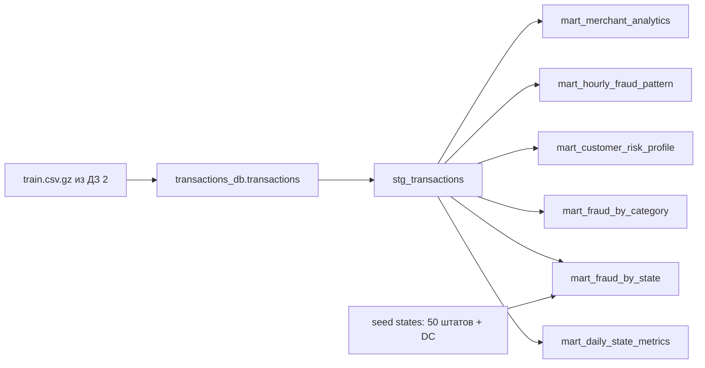

# ДЗ №4

Проект реализует все пункты критерия на 10 баллов.
Было сделано: шесть витрин, собственные макросы, три стандартных пакета, описания и тесты,
unit tests, SQLFluff, pre-commit и Makefile.

В дз реальные размеченные данные из ДЗ №2.

## Запуск

Нужны Python 3.12, Docker Desktop и Docker Compose v2. Команды выполняются
из корня этого репозитория. ClickHouse использует отдельный том проекта
`mlops-hw4` и порт `127.0.0.1:18124`.

```bash
python -m venv .venv
source .venv/bin/activate
python -m pip install -r requirements.txt
make up
make load
make deps
make build
make validate
make serve
```

Документация доступна по адресу **http://127.0.0.1:8084**.
`make validate` выполняет `dbt build`, `dbt test`, SQLFluff, `dbt docs generate`
и независимую сверку с CSV, сохраняя логи в `artifacts/`.

Проект добавлен в репозиторий ДЗ №2 через PR. Исходные данные уже находятся
в `teta-ml-1-2025/`, поэтому вложенная копия предыдущей работы не нужна.
По умолчанию `make load`, `make verify` и `make validate` используют
относительный путь `teta-ml-1-2025/train.csv.gz` внутри этого репозитория.
Команды запуска ДЗ №2 находятся в `hw2/`; команды ниже выполняются из корня
репозитория и запускают отдельное окружение ДЗ №4.

Загрузчик отказывается писать в непустую таблицу, чтобы повторный запуск
не удвоил операции. Если данные уже загружены, начинайте с `make deps`.
Сообщение `Table already contains 786431 rows` означает, что полный train уже
находится в ClickHouse: повторять `make load` и удалять данные не нужно.
`make down` останавливает окружение и сохраняет данные. После прерванной
частичной загрузки проверьте число строк и очистите только таблицу этого
отдельного окружения перед повторной загрузкой.

## Данные и архитектура



В ДЗ №2 нормализованная таблица называется `hw2.transactions`, а большая
часть полей сохранена внутри `raw_json`. Здесь загрузчик восстанавливает
из того же исходного CSV таблицу **`transactions_db.transactions`**, как требует в задании.


Staging материализуется как view, витрины — как таблицы MergeTree в базе
`analytics`. В staging строки очищаются, суммы переводятся в Decimal(18,2),
добавляются дата, ISO день недели, час, сегмент суммы и ключ клиента.

| Витрина | Ключ / число строк полного прогона | Содержание |
|---|---|---|
| `mart_daily_state_metrics` | дата + штат / 21 480 | Число операций, сумма, средний чек, точный P95, доля крупных операций |
| `mart_fraud_by_category` | категория / 14 | Число операций и фродов, fraud_rate, общая сумма и сумма фрода |
| `mart_fraud_by_state` | штат / 51 | Фрод, уникальные клиенты и мерчанты, суммы, название штата |
| `mart_customer_risk_profile` | клиент / 965 | Первая и последняя операция, объём, средний чек, fraud_rate, уровень риска |
| `mart_hourly_fraud_pattern` | день недели + час / 168 | Число операций, фрод, суммы и флаг высокого риска |
| `mart_merchant_analytics` | мерчант / 693 | Оборот, клиенты, фрод, средний чек, флаг подозрительности |

Бизнес-правила:

- `fraud_rate` и `large_transaction_share` выражены **в процентах (0–100)**.
- `amount_bucket`: SMALL <100, MEDIUM от 100 до <1000, LARGE ≥1000.
- Риск клиента: HIGH ≥5%, MEDIUM от 1% до <5%, LOW <1%.
- Высокий риск временного окна: fraud_rate ≥5%.
- Подозрительный мерчант: fraud_rate ≥5% и минимум 20 транзакций.
- Время исходного CSV не имеет часового пояса. Принята единая интерпретация
  UTC; часы не являются локальным временем каждого штата.
- Клиентский ID строится по нормализованным имени, фамилии, полу и координатам.
  В датасете нет надёжного уникального ID клиента, поэтому это приближение.
- Риск рассчитывается по всей доступной истории с истинными метками: это
  описательная аналитика. Для онлайн-прогноза потребуется отсечение будущих данных.

## Макросы, пакеты и проверки

Собственные макросы `amount_bucket` и `risk_level` используются в моделях.
`dbt_utils.generate_surrogate_key` создаёт клиентский ID;
`dbt_utils.unique_combination_of_columns` проверяет зерно каждой витрины.
`dbt_date.day_of_week` используется в staging с явной ClickHouse-реализацией
dispatch, поскольку пакет версии 0.10.1 не содержит такой реализации.
`dbt_expectations.expect_column_values_to_be_between` проверяет суммы ≥0.
Версии пакетов зафиксированы в `packages.yml` и `package-lock.yml`.

Все модели и колонки описаны в YAML. Проверки включают:

- 96 data tests: `not_null`, `unique`, `accepted_values`, связь штатов со справочником,
  составные ключи, проверку dbt_expectations и четыре singular SQL tests.
- Singular tests: отсутствие отрицательных сумм, fraud_rate в пределах 0–100,
  сохранение сумм и количества операций во всех витринах, классификация риска.
- 2 настоящих dbt unit tests с SQL-фикстурами: очистка строк, границы суммы
  99.99/100/999.99/1000, понедельник/воскресенье и часы; границы клиентского
  fraud_rate 0/1/4/5% с проверкой агрегатов и уровня риска.
- Независимая сверка с CSV через `make verify`: все показатели категорий и
  общие количество, сумма и число фродов в витринах, где эта метрика есть.

Полный `dbt build`: **PASS=106 WARN=0 ERROR=0 SKIP=0**.
Отдельный `dbt test`: **PASS=98 WARN=0 ERROR=0 SKIP=0**.
Логи и машинные результаты: [build](artifacts/dbt_build.log),
[test](artifacts/dbt_test.log), [run_results](artifacts/dbt_test_results.json),
[SQLFluff](artifacts/sqlfluff.log), [Docs](artifacts/dbt_docs.log).

## Линтинг и документация

```bash
make lint
pre-commit install
# После добавления файлов в Git:
pre-commit run --all-files
make docs
make serve
```

SQLFluff настроен на `clickhouse` и dbt templater. В конфигурации отключено
изменение регистра функций: ClickHouse использует имена вида `sumIf` и
`uniqExact`. Для параметрического `quantileExact(0.95)(amount)` добавлено
локальное исключение PRS/AL03, поскольку парсер SQLFluff 3.4.2 не распознаёт
этот синтаксис. Его выполнение проверяет ClickHouse при `dbt build`.
Для сгенерированного выражения дня недели локально отключена проверка длины строки.
Pre-commit использует тот же SQLFluff из активного окружения; пакеты dbt должны
быть установлены, а ClickHouse доступен для dbt templater.


[Скриншот страницы staging с описаниями колонок](artifacts/dbt_docs.png).

Скриншоты создаются с настоящей страницы dbt Docs. Для повторного создания
нужен установленный Google Chrome:

```bash
python -m pip install -r requirements-preview.txt
python scripts/capture_docs.py
```


Подготовленное описание сдачи находится в [PR_DESCRIPTION.md](PR_DESCRIPTION.md).
