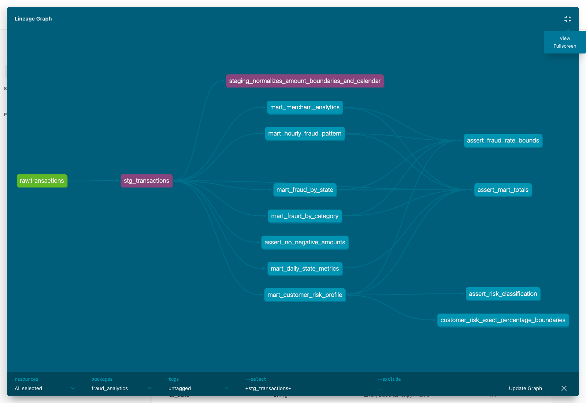

# ДЗ №4: dbt-аналитика фрода в ClickHouse

Из размеченных транзакций ДЗ №2 построен проект `dbt/` со слоями
`transactions_db.transactions → stg_transactions → marts`.
Реализованы все шесть витрин: дневные метрики по штатам, фрод по категориям
и штатам, профили риска клиентов, временные паттерны и аналитика мерчантов.

Добавлены собственные макросы сегментации суммы и риска, пакеты `dbt_utils`,
`dbt_date`, `dbt_expectations`, справочник 50 штатов и DC, описания моделей
и колонок, SQLFluff, `.pre-commit-config.yaml` и Makefile.
Загрузчик использует исходный `train.csv.gz`; неразмеченный test не включён
в расчёт fraud_rate. Данные прежних домашних работ не изменяются.
`make load`, `make verify` и `make validate` используют внутренний относительный
путь `teta-ml-1-2025/train.csv.gz` существующего репозитория ДЗ №2.
Вложенная копия предыдущего ДЗ и повторное добавление датасетов не требуются.

Проверено на полном train: 786 431 операция, 4 504 фрода, сумма 55 239 932,49.
Версии: **dbt-core 1.9.11**, **dbt-clickhouse 1.9.8**, ClickHouse 25.3.6.56,
SQLFluff 3.4.2, Python 3.12.

Проверки:

- `dbt build`: **PASS=106 WARN=0 ERROR=0 SKIP=0** — [лог](artifacts/dbt_build.log).
- `dbt test`: **PASS=98 WARN=0 ERROR=0 SKIP=0** — [лог](artifacts/dbt_test.log).
- 96 data tests: обязательные значения, уникальность, допустимые значения,
  связи со справочником, составные ключи и dbt_expectations.
- 4 singular tests: отрицательные суммы, границы fraud_rate, сохранение итогов
  всех витрин и классификация клиентского риска.
- 2 unit tests: нормализация, границы сегментов суммы, ISO календарь и границы риска.
- SQLFluff проходит — [лог](artifacts/sqlfluff.log).
- Итоги всех шести витрин совпадают с независимым расчётом из CSV через Decimal —
  [отчёт](artifacts/verification.json).
- `dbt docs generate` выполнен — [лог](artifacts/dbt_docs.log).

[Страница staging в dbt Docs](artifacts/dbt_docs.png).

Команды воспроизведения и определения метрик описаны в [HW4.md](HW4.md).
